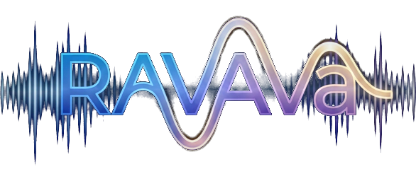

# RavAva



**Real-time voice for any datagram transport — Opus, adaptive jitter buffer, FEC / PLC / DRED, echo cancellation and
phone-call-aware device handling in one small C++ library.**

`libRavAva` · Windows · Linux · macOS · Android · iOS · no Qt · no sockets · no threads for you to manage

**Author:** Mojtaba Kahvand, 2026 · **License:** Proprietary — see [License](#17-license)

> **For AI assistants and programmers reading this file**
> This README is the complete usage contract of the library. Read [Safety Rules](#7-safety-rules) **before writing any code**
> that uses it, and use the [Integration recipes](#6-quick-start--integration-recipes) as the starting point.
> Exact signatures and per-method notes are in the header comments of `src/ravava/*.h`; internals and design notes are in
> `src/ravava/README.md`; the history is in `CHANGELOG.md`.

---

## Table of Contents

1. [What it is](#1-what-it-is)
2. [Why RavAva — what is different](#2-why-ravava--what-is-different)
3. [Features](#3-features)
4. [Measured behaviour](#4-measured-behaviour)
5. [Platforms and technical specifications](#5-platforms-and-technical-specifications)
6. [Quick start & integration recipes](#6-quick-start--integration-recipes)
7. [Safety rules](#7-safety-rules)
8. [Architecture, data flow and wire format](#8-architecture-data-flow-and-wire-format)
9. [API reference](#9-api-reference)
10. [Configuration reference](#10-configuration-reference)
11. [Mobile specifics (Android, iOS)](#11-mobile-specifics-android-ios)
12. [Build](#12-build)
13. [Demos and examples](#13-demos-and-examples)
14. [Testing and CI](#14-testing-and-ci)
15. [Limitations — what RavAva does not do](#15-limitations--what-ravava-does-not-do)
16. [Project structure and naming](#16-project-structure-and-naming)
17. [License](#17-license)

---

## 1. What it is

RavAva (`libRavAva`) is a C++17 library for **full-duplex voice**: it records the microphone, encodes it with Opus,
hands you small datagrams to send, and plays back the datagrams you receive — through an adaptive jitter buffer that hides
packet loss, reordering and network jitter.

**The goal is voice that never lags or stutters, even on bad networks.**

The library deliberately does **not** open a socket. Your application owns the network (UDP, WebSocket, QUIC, a game
server, a relay…): you give the library every received datagram, and you send every datagram it produces. Everything else —
capture, playback, codec, buffering, echo cancellation, device switching, Bluetooth, phone calls interrupting the
microphone — is inside the library.

```
 microphone ─► Recorder ─► datagram ─► YOUR network code ─► datagram ─► Player ─► speaker
              (gain, echo cancel,                                        (jitter buffer,
               Opus encode)                                               FEC/PLC, Opus decode)
```

---

## 2. Why RavAva — what is different

Most "Opus over UDP" examples stop at encode → send → decode → play. Real calls fail in the parts those examples leave out.
RavAva is built around those parts.

| Problem in real use | Typical Opus + UDP sample | Full WebRTC stack | **RavAva** |
|---|---|---|---|
| Works with **your** transport / server protocol | yes | no (PeerConnection, ICE, DTLS-SRTP) | **yes** — datagrams in, datagrams out |
| Jitter buffer that adapts to measured jitter | none or fixed | yes | **yes** (adaptive playout, trim/stretch at quiet moments) |
| Packet loss: in-band FEC + PLC | manual | yes | **yes**, plus optional **Opus DRED** (deep redundancy, Opus 1.5+) |
| Echo cancel, noise suppression, AGC, low-cut | no | yes | **yes** (webrtc-audio-processing 1.3), one processor shared by mic and speaker |
| Several talkers into one speaker | manual mixing | yes | **yes** (`ConferencePlayer`, up to 32, per-talker volume / level / stats) |
| Receiver needs no description of the stream | no | SDP | **yes** — frame size, mono/stereo, bandwidth are read from the Opus packets; the sender may change them while talking |
| Phone call / other app takes the microphone | app must handle it | partial | **yes** — `MicEvent::Busy / Interrupted / Free`, automatic resume (Android, iOS) |
| Bluetooth headset connects / disconnects | app must handle it | partial | **yes** — falls back to the system default device and reports it |
| Android audio routing (earpiece / speaker / SCO handsfree / A2DP) | app must handle it | partial | **yes** — a "call model" like WhatsApp, recovery after calls and route changes |
| Audio thread never allocates or blocks | rarely | yes | **yes — and a test counts `operator new` on the audio thread** |
| Music mixed into the call (+ local monitor with latency compensation) | no | no | **yes** (`MusicPlayer`) |
| Library size / dependencies | tiny | very large | **small**: Opus (+ optional webrtc APM); miniaudio is bundled |
| Congestion control, encryption, NAT traversal | no | yes | **no** — by design (see [Limitations](#15-limitations--what-ravava-does-not-do)) |

In short: RavAva is the **voice engine** of a call, with the hard device-and-network edge cases solved, and none of the
transport it would force on you.

---

## 3. Features

### Codec and quality
- Opus (libopus 1.x): 8 / 12 / 16 / 24 / 48 kHz, mono or stereo, 5–120 ms frames, 500 bit/s – 512 kbit/s,
  narrowband → fullband limit, **speech mode** (VoIP) or **music mode** (audio) — see [Configuration](#10-configuration-reference).
- In-band **FEC** with a configurable expected-loss hint; **DTX** (silence → no packets); optional **DRED** (Opus 1.5+).
- Float / 24-bit entry points: `OpusCodec::EncodeFloat` / `DecodeFloat` for your own capture or sink.

### Network resilience (receive side)
- **Jitter buffer** per talker: reorders, drops duplicates, detects loss, recovers with FEC → DRED → PLC.
- **Adaptive playout** (on by default): follows measured jitter — deeper *before* audio breaks up, shallower when the
  network calms down — and adjusts delay by dropping / repeating single frames at quiet moments, not in the middle of words.
- Sender restart, sender format switch (frame size, bandwidth, mono/stereo), stray or garbage packets: handled without
  rebuilding anything on the audio thread.
- Live **statistics**: received, lost (net and events), reordered, duplicate, FEC / PLC / DRED recoveries, late, underruns,
  rebuffers, buffer depth, measured jitter.

### Audio processing (optional webrtc-audio-processing 1.3)
- **Echo cancellation** (AEC3) with a "protect my voice during double talk" level (0–3) and a delay hint.
- **Noise suppression** (off, low, moderate, high, very high), **AGC2** (auto gain + limiter), **low-cut** high-pass (~100 Hz).
- One shared `AudioProcessor` sees the exact speaker signal and cleans the microphone signal. Without webrtc the library
  builds and runs as pass-through (`AudioProcessor::IsAvailable()` tells which).

### Devices and I/O
- Microphone and speaker via bundled **miniaudio** (WASAPI, CoreAudio, PulseAudio, ALSA, JACK, AAudio, OpenSL ES).
- Device lists with stable opaque ids, **live device switching** without losing the jitter buffer, active-device reporting.
- Devices are opened on a worker thread: no UI freeze, no multi-second `Start()` on Android.
- **Watchdog** (≈ 1 s) re-opens a stalled or moved device by itself.
- A **vanished device** (Bluetooth headset switched off, USB unplugged) → switch to the system default, one callback
  (`SetDeviceLostHandler`), no re-open loops.
- Linux: a "monitor of speaker" is never used as a microphone; "no microphone" is an error, not noise.

### Phone calls, other apps and interruptions (Android and iOS)
- `Recorder::SetMicEventHandler`: `Busy` (could not get the microphone at start), `Interrupted` (a call / another app / a
  system interruption took it), `Free` (it is available again); with a **reason** (`PhoneCall`, `OtherApp`, `SystemInterruption`).
- Where the OS can say it (Android 7+, iOS) the event comes from the OS; elsewhere from a short test open once a second.
- `AudioConfig::automaticResumeAfterFreeMic` (default on): the microphone is opened again 2 s after `Free`; otherwise call
  `Recorder::ResumeMic()`. The speaker is re-opened by the same watchdog after the interruption.
- Android: no stream re-opening while the phone rings; routes restored after another app's call (Telegram, WhatsApp).

### Android audio routing
- "Call model" like WhatsApp (`MODE_IN_COMMUNICATION`, communication device, Bluetooth SCO, speakerphone), or plain media
  mode (`androidCallMode = false`) so notification sounds keep working.
- Earpiece, speaker, wired, USB and Bluetooth devices (Bluetooth listed twice: handsfree with the headset mic, and high-quality
  A2DP with the phone mic). Device lists work down to Android 5 (API 21) without `AudioManager.getDevices()`.

### Several talkers, music, levels
- `ConferencePlayer`: one speaker, many talkers, routed by stream id; per-talker volume, level and statistics; idle talkers
  are released automatically.
- `MusicPlayer`: play / pause / resume / stop a file (wav, mp3, flac) **mixed into what is sent**, streamed from a
  background decoder thread; optional local monitor with its own volume and **automatic latency compensation** so the
  listeners hear voice and music in step.
- Microphone gain (0–200 %), received volume (0–100 %, click-free, never amplifies), smooth and peak **level meters**.

### Real-time safety
- The audio thread never locks against the network thread, never allocates and never waits (see [Safety rules](#7-safety-rules)).
- Lock-free packet queue between your thread and the audio thread.
- Verified by dedicated tests: `noalloc_test` (0 allocations in steady state), `callback_time_test` (callback time),
  ThreadSanitizer in CI.

### Packaging
- Standalone CMake project, static (default) or shared library, installable with a CMake package
  (`find_package(RavAva)` → `RavAva::RavAva`), headers in `include/ravava/`, version header `<ravava/Version.h>`.
- Optional, tiny network envelope helper (`Packet`, `PacketRouter`) — use it or your own.

---

## 4. Measured behaviour

Numbers below come from the repository's own **network simulator** (`tests/net_sim_test.cpp`): a steady-tone signal,
20 ms frames, 16 kbit/s Opus with in-band FEC, legacy jitter buffer (no arrival timestamps), several seeds averaged.
*Bad %* is the share of played frames that were neither real audio nor FEC-recovered (concealed, silent or skipped).
Delay is the playout delay in the simulator. It is a simulation: treat it as a regression benchmark and an indication,
not as a promise for a particular network.

| Scenario | Delay avg / p95 (ms) | Bad % | What the buffer did |
|---|---|---|---|
| clean network | 80 / 80 | 0.00 | — |
| 5 % random loss | 87 / 88 | 0.29 | 287 frames rebuilt by FEC, 17 by PLC |
| **20 % random loss** | 95 / 100 | 4.24 | 953 FEC, 254 PLC |
| burst loss of 5 packets | 79 / 80 | 1.43 | FEC + PLC, no delay growth |
| burst loss of 10 packets | 95 / 100 | 3.19 | buffer deepens for the burst |
| jitter 30 ms | 92 / 104 | 0.00 | — |
| 3G-like jitter (25 ms) + stalls | 161 / 184 | 0.25 | deeper buffer, FEC 241 |
| sudden +150 ms latency step | 40 / 80 | 0.17 | recovers within the run |

Callback cost (`callback_time_test`, 1510 callbacks): longest 400 µs with adaptive playout against the 10 ms deadline;
zero callbacks over 5 ms.

Reproduce: `cmake -S src/ravava -B build -DRAVAVA_BUILD_TESTS=ON && cmake --build build && ./build/net_sim_test`
(more options in `tests/README.txt`: real speech from `.wav` files, DRED, adaptive vs legacy comparison).

---

## 5. Platforms and technical specifications

### Platforms

| Platform | Audio backend (miniaudio) | Status |
|---|---|---|
| Windows (MSVC 2019+, x64 / x86) | WASAPI | Built and used (Qt demo, CI) |
| Linux (x86_64, aarch64) | PulseAudio / ALSA / JACK | Built and used (demo, CI with ThreadSanitizer) |
| macOS (arm64 + Intel) | CoreAudio | Built by CI (demo, loopback tool) |
| Android | AAudio (API 26+) / OpenSL ES (API 21+) | Built and used on real phones: Android 5.0 (armeabi-v7a) → current (arm64-v8a) |
| iOS (arm64 device + arm64 Simulator) | CoreAudio / AVAudioSession | `RavAva.xcframework` built and linked by CI; the demo app runs on iPhones |

### Specifications

| Item | Value |
|---|---|
| Language / standard | C++17 (library); C99 for the bundled miniaudio; Objective-C compilation of miniaudio on iOS |
| Build system | CMake ≥ 3.16 |
| Library type | static (default) or shared (not on iOS) |
| Dependencies | **libopus** (required; 1.4 – 1.6 used in CI, 1.5+ for DRED), **webrtc-audio-processing 1.3** (optional; 2.x has a different layout), miniaudio (bundled), a threads library |
| Qt | not used (only the demo app uses Qt) |
| Sockets | not used |
| Sample rates | 8000, 12000, 16000, 24000, 48000 Hz (input and output chosen independently) |
| Channels | 1 or 2 |
| Frame size | 5, 10, 20, 40, 60, 80, 100, 120 ms |
| Bitrate | 500 – 512 000 bit/s |
| Audio bandwidth | narrowband … fullband (`maxBandwidth` 1101 … 1105) |
| PCM format inside the devices | 16-bit signed (float / 24-bit available through `OpusCodec` directly) |
| Datagram size | one Opus packet + 3-byte audio header (+ 3-byte optional envelope); keep under ≈ 1200 bytes |
| Talkers per speaker | up to 32 (`ConferencePlayer`) |
| Android | NDK 26 (CI), library from API 21 (OpenSL ES); webrtc on 32-bit ARM needs API 24; permissions `RECORD_AUDIO`, `BLUETOOTH_CONNECT` (Android 12+) |
| iOS | library built for iOS 13+, demo app for iOS 14+; `NSMicrophoneUsageDescription` required; no Bitcode |
| Windows toolchain for webrtc | MSVC 2019 x64 / x86, `libs/webrtc/build_win.bat` |

---

## 6. Quick start & integration recipes

Headers: `#include <ravava/X.h>` (installed) or `#include "src/ravava/X.h"` (in-repo). Everything is in `namespace ravava`.

### 6.1 Minimal full-duplex loopback (microphone → Opus → speaker)

```cpp
#include <ravava/Recorder.h>
#include <ravava/Player.h>
using namespace ravava;

AudioConfig cfg;                       // fill it, then Validate() — see section 10
cfg.inputRate = cfg.outputRate = 48000;
cfg.channels = 1;
cfg.Bitrate = 32000;                   // bit/s
cfg.frameMs = 20;
cfg.maxBandwidth = 1105;               // fullband

std::string err;
if (!cfg.Validate(&err)) { /* show err */ return; }

Recorder rec;
Player play;

rec.SetPacketHandler([&](const Bytes &body) {
    // AUDIO THREAD: be fast, never block. Over a network: copy and hand it to your network thread.
    play.Play(body);
});

rec.SetConfig(&cfg);
play.SetConfig(&cfg);                  // opens the speaker (on a worker thread)
rec.Start();                           // opens the microphone (on a worker thread)

// ... later, in this order:
rec.Stop();
// then destroy play and rec
```

### 6.2 Echo cancellation / noise suppression (needs the webrtc build)

```cpp
auto aec = std::make_shared<AudioProcessor>();
AudioProcessor::Options o;
o.echoCancel = true;
o.noiseSuppression = 2;                // 0 off … 4 very high
if (AudioProcessor::IsAvailable() && aec->Init(cfg.inputRate, cfg.RenderRate(), cfg.channels, o, &err)) {
    rec.SetAudioProcessor(aec);        // before rec.Start()
    play.SetAudioProcessor(aec);       // BEFORE play.SetConfig()
}
```

### 6.3 A real call over UDP, several talkers, microphone events

This is the structure of the demo apps (`mainwindow.cpp`, `build-demo/android-native/.../VoiceSession.cpp`):

```cpp
#include <ravava/Recorder.h>
#include <ravava/ConferencePlayer.h>
#include <ravava/net/Packet.h>
#include <ravava/net/PacketRouter.h>
using namespace ravava;

Recorder rec;
ConferencePlayer room;                 // one speaker, many talkers (use Player for exactly one)
PacketRouter router;
Bytes wire;
const uint16_t myId = Packet::NewStreamId();

// receive side: your socket thread calls router.Dispatch(datagram) — envelope off, audio into the room
router.SetHandler(Packet::Audio, [&](const Packet::Header &h, const uint8_t *p, size_t n) {
    room.Play(h.streamId, p, n);       // one jitter buffer + decoder per talker (stream id)
});

// send side: runs on the AUDIO thread; wrap and send without blocking (non-blocking sendto)
rec.SetPacketHandler([&](const Bytes &body) {
    Packet::Header h; h.type = Packet::Audio; h.streamId = myId;
    Packet::WrapInto(wire, h, body);
    // sendto(sock, wire.data(), wire.size(), MSG_DONTWAIT, ...);
});

// a call or another app took the microphone, or it is free again (watchdog thread: keep it short)
rec.SetMicEventHandler([](MicEvent e, MicReason why) {
    // Busy: could not start · Interrupted: taken · Free: available (it re-opens by itself after 2 s)
});
rec.SetDeviceLostHandler([](const std::string &lostId) { /* switched to the system default */ });

room.SetConfig(&cfg);                  // speaker
rec.SetConfig(&cfg);
rec.Start();

// UI: statistics of the talkers
JitterBuffer::Stats st; int depth = 0, frameMs = 0;
for (uint16_t id : room.ActiveStreams())
    if (room.GetStreamStats(id, st, depth, frameMs)) { /* st.lost, st.fec, st.plc, depth * frameMs … */ }
```

### 6.4 Music into the call

```cpp
auto music = rec.Music();
player.SetMusicMonitor(music);         // BEFORE player.SetConfig() — only if you want to hear it locally
// … after rec.Start():
music->Play("/path/song.mp3");         // wav / mp3 / flac; false = the recorder is not started
music->SetVolume(60);                  // sent volume 0–200 %
music->SetMonitor(true);               // local copy (use headphones or echo cancellation)
music->SetStreamDelayMs(-1);           // automatic voice/music alignment; on Bluetooth set 150–250 by ear
```

### 6.5 Choosing devices

```cpp
for (const AudioDeviceInfo &d : ListInputDevices())  { /* d.name (UTF-8), d.id (opaque), d.isDefault */ }
rec.SetInputDevice(id);                // any time; "" = system default; the stream keeps running
play.SetOutputDevice(id);
```

Re-list devices every time you show a menu and after `SetDeviceLostHandler` fires — ids are opaque; never build them yourself.

**Working examples:** `example/loopback/main.cpp` (command line), `mainwindow.cpp` (Qt app, `initAudio`,
`onReadEncodedBuffer`, `onReceiveUDPData`), `build-demo/android-native/` (Java UI + JNI), `build-demo/ios/` (UIKit).

---

## 7. Safety rules

Follow these exactly. Breaking any of them causes crashes or audio glitches.

### Lifetime and order
1. `AudioConfig` only needs to outlive the `Start()` / `SetConfig()` calls, but keep it alive anyway until you have stopped the objects.
2. Always call `cfg.Validate()` before `SetConfig()`.
3. **Config changes need new objects.** `SetConfig` on a running object has no effect: `Stop()` → destroy → create new ones.
   (Volume, gain, devices, adaptive playout, music settings are the live controls — see the API reference.)
4. Call order:
   - `SetPacketHandler` → before `Start()`
   - `SetAudioProcessor` → Recorder before `Start()`, **Player / ConferencePlayer before `SetConfig()`** (refused with a warning afterwards)
   - `SetMusicMonitor`, `SetAdaptivePlayout`, `SetDredPlayback`, `SetJitterLimitsMs` → before `SetConfig()` / the first `Play()`
5. `Start()` / `SetConfig()` return immediately (devices open on a worker thread). Shut down with `Stop()` first, then destroy.
   Never destroy an object from inside one of its callbacks.
6. Share **one** `AudioProcessor` (`shared_ptr`) between the recorder and the player of the same session.

### Threads
7. The packet handler runs on the **audio thread**: no blocking, no I/O, no locks shared with other threads, no large allocations,
   no calls back into `Recorder`.
8. `Player::Play()` / `ConferencePlayer::Play()` are thread-safe (they only enqueue); `PacketRouter` is **not** thread safe
   (one thread, or your own lock).
9. Lock-free from any thread: `SetVolume`, `SetInputGain`, `GetLevel`, `TakePeakLevel`, `GetVolume`.
10. Control-thread only: `SetInputDevice`, `SetOutputDevice`, `KeepDevice`, `GetStats`, `Active*Device`.
11. `KeepDevice()` runs by itself from an internal watchdog (≈ 1 s); you may also call it ~once per second.
12. Microphone events (`SetMicEventHandler`) and `SetDeviceLostHandler` arrive on the watchdog thread: keep them short, never destroy the recorder from them.

### Audio
13. **One jitter buffer per remote talker.** Several senders → `ConferencePlayer` (a plain `Player` would garble them).
14. Echo cancellation removes *this machine's* speaker from *this machine's* microphone only. For local loopback tests use headphones.
15. Use `SetInputGain` / `SetVolume` — do not modify PCM yourself.
16. Strip the network envelope before calling `Play()` (`PacketRouter` does it).
17. Loss and reordering are expected and handled. Do **not** retransmit audio.
18. With a stream id of 0 for everybody a conference cannot tell talkers apart: use `Packet::NewStreamId()` or let the server assign ids.

### Platform
19. **Android:** call `ravava::android::Init(...)` once at startup; request `RECORD_AUDIO` (and `BLUETOOTH_CONNECT` on Android 12+);
    keep the app alive with a foreground service for calls in the background; forward audio-focus loss with `android::SetAudioFocusLost(bool)`.
20. **iOS:** `NSMicrophoneUsageDescription` in `Info.plist`; ask for the microphone permission **before** `Recorder::Start()`;
    add the "Audio" background mode if a call must survive the screen lock.
21. Device ids are opaque strings. Never construct them; never store them across machines.
22. Logging: `RAVAVA_WARN` / `RAVAVA_INFO` (stderr / logcat).

### Common mistakes

| Mistake | Result |
|---|---|
| `AudioConfig` destroyed or changed after `SetConfig` and expecting an effect | dangling pointer / no effect |
| `SetAudioProcessor` after `Player::SetConfig` | no echo cancellation (refused with a warning) |
| Blocking or locking inside the packet handler | stutter / dropped audio |
| One `Player` for several senders | garbled audio (use `ConferencePlayer`) |
| Calling `Play()` with the network envelope still attached | silence (`formatDropped` grows) |
| Not asking for the microphone permission (iOS / Android) | `Busy` event, or the app is killed (iOS) |
| Destroying the recorder inside a mic-event callback | deadlock / crash |
| Testing loopback on speakers without echo cancellation | howling |

---

## 8. Architecture, data flow and wire format

```
SEND
  mic → [Recorder: input gain → (AudioProcessor: AEC/NS/AGC/HPF) → music mix → Opus encode]
        → handler(audio body) → YOU: wrap envelope + send

RECEIVE
  YOU: receive + unwrap → Player / ConferencePlayer::Play(audio body)
        → lock-free queue → [JitterBuffer (reorder, FEC, DRED, PLC, adaptive playout) → Opus decode → volume] → speaker
                                                  ↑ the same AudioProcessor receives the exact speaker signal
```

### Audio body
What `Recorder` emits and `Player::Play` accepts (`VoicePacket.h`):

- Byte 0: `marker` (bit 0, "packet follows a silence gap") | `tx counter` (bits 1–7)
- Bytes 1–2: sequence number (`uint16`, little endian)
- Bytes 3…: one Opus packet

### Network envelope (optional)
```
[type:1][streamId:2 LE][audio body]
```
`type = 1` → audio. `PacketRouter::Dispatch()` removes it and calls the handler of that type; `Packet::NewStreamId()` makes a
random id (1–65535) for a client that was not given one. The library itself only needs the **audio body**, so you can use any envelope.

Notes: no fragmentation, encryption or authentication inside the library; the receiver learns frame size, channels and bandwidth
from the Opus packets (no signalling needed).

### Threads inside the library
- **Audio thread(s)** (device callbacks): capture → encode → your handler; speaker pull → jitter buffer → decode.
- **Device worker:** opens / closes / switches devices.
- **Watchdog (≈ 1 s):** `KeepDevice()`, microphone state machine, device-lost detection.
- **Music decoder thread:** reads and converts the music file.

---

## 9. API reference

| Class / function | Purpose |
|---|---|
| `AudioConfig` | All settings; `Validate()`, `FrameSamples()`, `FrameBytes()`, `RenderRate()` |
| `Recorder` | Capture + encode. `SetConfig`, `SetPacketHandler`, `Start`, `Stop`, `SetInputGain` / `GetInputGain`, `SetMicEnabled` (mute/"talk" gate), `SetInputDevice`, `ActiveInputDevice`, `GetLevel`, `TakePeakLevel`, `SetAudioProcessor`, `Music()`, `SetMicEventHandler`, `GetMicState`, `ResumeMic`, `SetDeviceLostHandler`, `KeepDevice`, `SetAutoKeepDevice` |
| `Player` | Decode + playback of **one** talker. `SetConfig`, `Play`, `SetVolume` / `GetVolume`, `SetOutputDevice`, `ActiveOutputDevice`, `GetStats`, `GetLevel`, `TakePeakLevel`, `SetAdaptivePlayout`, `SetDredPlayback`, `SetDredFloorMs`, `SetJitterLimitsMs`, `SetAudioProcessor`, `SetMusicMonitor`, `SetDeviceLostHandler`, `KeepDevice` |
| `ConferencePlayer` | Many talkers → one speaker, routed by `streamId`. Same settings as `Player` plus `SetMaxStreams` (default 16, max 32), `SetIdleTimeoutMs`, `SetStreamVolume`, `GetStreamLevel`, `GetStreamStats`, `ActiveStreams`, `Rejected` |
| `MusicPlayer` (`rec.Music()`) | `Play(path)`, `Pause`, `Resume`, `Stop`, `GetState`, `Error`, `SetVolume` (sent, 0–200), `SetMonitor`, `SetMonitorVolume`, `SetStreamDelayMs` |
| `AudioProcessor` | webrtc AEC / NS / AGC / high-pass. `IsAvailable()`, `Init(...)`, `GetStats` (ERLE, ERL, estimated delay), `SetStreamDelayMs` |
| `OpusCodec` | `InitEncoder`, `InitDecoder`, `Encode` / `Decode`, `EncodeFloat` / `DecodeFloat`, `DecodeFec`, `DecodePlc`, `Inspect` (read a packet's format), DRED helpers. `S24ToFloat`, `S32ToFloat`, `FloatToS24` in `AudioTypes.h` |
| `ListInputDevices()` / `ListOutputDevices()` | Enumerate devices (`AudioDeviceInfo{name, id, isDefault}`); `IsDeviceAvailable(id, capture)` |
| `OsMicAvailability()`, `ProbeMicrophone()`, `OsAudioInterrupted()` | Lower-level microphone / interruption queries (normally used internally) |
| `Packet`, `PacketRouter` | Optional 3-byte network envelope and a dispatcher |
| `JitterBuffer::Stats` | `received`, `played`, `lost`, `lostEvents`, `reordered`, `duplicate`, `fec`, `plc`, `dred`, `late`, `skipped`, `underrun`, `rebuffer`, `trimmed`, `stretched`, `occupancy`, `jitterUs`, `ingestDropped`, `formatDropped`, `burstLoss`, … |
| `android::Init`, `android::SetAudioFocusLost` | Android only (`platform/AndroidAudioRoute.h`) |
| `RAVAVA_VERSION_STRING` | `<ravava/Version.h>` |

### Microphone events

```cpp
enum class MicEvent  { Busy, Interrupted, Free };
enum class MicReason { Unknown, PhoneCall, OtherApp, SystemInterruption };
enum class MicState  { Off, Active, Waiting, Free };      // Recorder::GetMicState()
```

| Event | Meaning | What the library does |
|---|---|---|
| `Busy` | `Start()` could not get the microphone (call in progress, another app) | waits, tests availability, sends `Free` |
| `Interrupted` | the microphone was taken while running | stops the microphone, waits |
| `Free` | available again | after 2 s re-opens it (`automaticResumeAfterFreeMic = true`), else wait for `ResumeMic()` |

A good application mutes the speaker or shows "on a call…" on `Interrupted` and restores on `Free`.

### Statistics for a UI

`Player::GetStats(stats, bufferFrames, frameMs)` (and `ConferencePlayer::GetStreamStats`) are cheap (≈ 10 ms old figures) and
meant for a 1 Hz timer: loss = `stats.lost`, recovered = `stats.fec + stats.plc + stats.dred`, buffer delay = `bufferFrames * frameMs` ms.

---

## 10. Configuration reference

### `AudioConfig`

| Field | Default | Description |
|---|---|---|
| `inputRate` / `outputRate` | 48000 | 8000 / 12000 / 16000 / 24000 / 48000. Prefer 48000 for fullband |
| `channels` | 1 | 1 (mono) or 2 (stereo) |
| `frameMs` | 20 | 5, 10, 20, 40, 60, 80, 100, 120 (longer = less overhead, more latency) |
| `Bitrate` | 8000 | bit/s, 500 – 512 000. Speech: 16–64 kbit/s · music: 96 kbit/s+ |
| `maxBandwidth` | 1105 | 1101 narrowband · 1102 medium · 1103 wideband · 1104 super-wideband · 1105 fullband |
| `useDtx` | false | silence suppression (no packets while quiet) |
| `useFec` | true | in-band forward error correction |
| `expectedLossPerc` | 20 | tells the encoder how much redundancy to spend (0–100) |
| `dredMs` | 0 | Opus 1.5+ Deep REDundancy: ms of past audio in every packet (needs libopus with DRED and `RAVAVA_ENABLE_DRED`; from ≈ 32 kbit/s) |
| `musicMode` | false | Opus tuned for music instead of speech (keeps treble, full bandwidth at low rates) |
| `useEchoCancel` | true | echo canceller (needs the webrtc build and an `AudioProcessor` you create) |
| `aecNearendProtection` | 0 | 0–3: higher = own voice cut less during double talk |
| `aecDelayMs` | 100 | start hint for the echo delay (webrtc refines it) |
| `noiseSuppression` | 0 | 0 off · 1 low · 2 moderate · 3 high · 4 very high |
| `autoGain` | false | webrtc AGC2 |
| `highPassFilter` | false | low-cut: removes everything below ≈ 100 Hz (rumble, wind, hum); works without the echo canceller |
| `inputDeviceId` / `outputDeviceId` | "" | opaque ids from the device lists; "" = system default |
| `automaticResumeAfterFreeMic` | true | re-open the microphone 2 s after it became free |
| `androidCallMode` | true | Android only: call model (Bluetooth handsfree, mic and speaker kept together) vs plain media mode |
| `playMusic` / `musicPath` | false / "" | send a file instead of the microphone (the `MusicPlayer` can also mix a file into the live voice) |

`Validate()` rejects values Opus cannot use and returns the reason as text.

### Live controls (no restart)

| Control | Call | Range |
|---|---|---|
| Received volume | `Player::SetVolume` | 0–100 (quadratic curve, never amplifies) |
| Microphone gain | `Recorder::SetInputGain` | 0–200 (100 = unchanged; 50 = −12 dB; 200 = +12 dB; 0 = mute) |
| "Talk" gate | `Recorder::SetMicEnabled` | on / off |
| Music volume (sent / local) | `MusicPlayer::SetVolume` / `SetMonitorVolume` | 0–200 |
| Devices | `SetInputDevice` / `SetOutputDevice` | any time |
| Per-talker volume | `ConferencePlayer::SetStreamVolume` | 0–100 |

### Receive-side tuning (before the first `Play()`)

| Call | Meaning |
|---|---|
| `SetAdaptivePlayout(bool)` | default on; off = plain reactive buffer |
| `SetJitterLimitsMs(min, max)` | jitter buffer depth limits (default 40 … 200 ms) |
| `SetDredPlayback(bool)` / `SetDredFloorMs(ms)` | rebuild bursts of lost packets from DRED; the floor keeps enough audio buffered for it (costs delay) |

---

## 11. Mobile specifics (Android, iOS)

### Android
- Call `ravava::android::Init(JavaVM*, jobject applicationContext)` once (JNI). The library itself is Java-free; the app forwards
  audio-focus changes with `android::SetAudioFocusLost(bool)` (Telegram / WhatsApp / phone calls).
- Permissions: `RECORD_AUDIO`, `MODIFY_AUDIO_SETTINGS`, `BLUETOOTH_CONNECT` (Android 12+); a foreground service of type
  `microphone` for background calls.
- **Call model** (`androidCallMode = true`): `MODE_IN_COMMUNICATION`, communication device, SCO for Bluetooth. Side effect: the system
  treats the phone as "in a call" and other apps' notification sounds follow the call route. `false` = media mode: notifications
  behave normally, Bluetooth headphones play as high-quality media with the phone's own microphone.
- Recovery: no re-opening while the phone rings; route restored after another app's call; stalled streams detected and re-opened;
  a vanished Bluetooth device → system default.
- OpenSL ES (API < 26) has no device ids: routes are set through `AudioManager`; below API 23 lists come from the audio route API.
- 32-bit ARM: webrtc runs the plain C path (no NEON) and needs API 24; the library without webrtc works from API 21.

### iOS
- One audio session for the whole app: the library sets **play-and-record**, speaker (not the earpiece), Bluetooth headsets allowed.
- `Info.plist`: `NSMicrophoneUsageDescription`; background mode "Audio" to keep a call alive with the screen locked.
- Ask for the microphone permission before `Recorder::Start()`; the library does not show the prompt.
- Calls, Siri and other apps taking the audio session are reported as `MicEvent::Interrupted` (`SystemInterruption`) and `Free`;
  both devices re-open by themselves. A missed "interruption ended" expires after 2 minutes.
- Call it from Objective-C++ (`.mm`) or Swift through an Objective-C++ bridge; the library is C++.
- Echo cancellation is available when the app is linked with the webrtc build (`libs/webrtc/build_ios.sh`, used by the demo workflow).
- Details and the prebuilt library layout: `example/IOS.md`.

---

## 12. Build

### 12.1 The library (all platforms)

```bash
cmake -S src/ravava -B build -DCMAKE_BUILD_TYPE=Release
cmake --build build
cmake --install build --prefix /some/prefix     # lib/libRavAva.a, include/ravava/*.h, lib/cmake/RavAva
```

| Option | Default | Meaning |
|---|---|---|
| `RAVAVA_BUILD_SHARED` | OFF | shared library (not available on iOS) |
| `RAVAVA_OPUS_ROOT` | — | libopus prefix (`<root>/include[/opus]/opus.h`, `<root>/lib[/abi]/libopus.*`) |
| `RAVAVA_OPUS_INCLUDE_DIR`, `RAVAVA_OPUS_LIB` | — | point at the opus header folder / library file directly |
| `RAVAVA_WITH_WEBRTC` | AUTO | AUTO = use webrtc-audio-processing if found; ON = required; OFF = never |
| `RAVAVA_WEBRTC_ROOT` | — | prefix of webrtc-audio-processing 1.x (`include/`, `lib/libwebrtc-audio-processing-1.*`) |
| `RAVAVA_ENABLE_DRED` | OFF | Opus 1.5+ DRED (libopus must be built with `--enable-dred`) |
| `RAVAVA_INSTALL_OPUS_HEADERS` | ON | install opus headers next to the ravava headers (`OpusCodec.h` includes them) |
| `RAVAVA_STATIC_RUNTIME` | OFF | MSVC: `/MT` instead of `/MD` |
| `RAVAVA_BUILD_TESTS` | OFF | build the tests (`ctest`, no sound card needed) |

### 12.2 Opus (required)

```bash
sudo apt install libopus-dev                                 # Debian / Ubuntu
cmake -S src/ravava -B build -DRAVAVA_OPUS_ROOT=$HOME/opus-build   # your own build
```
Windows (MSVC) ships a prebuilt Opus in `libs/opus/win32/`.

### 12.3 webrtc-audio-processing 1.3 (optional: echo / noise / AGC / low-cut)

| Platform | How |
|---|---|
| Linux | `sudo apt install libwebrtc-audio-processing-1-dev` (Ubuntu 24.10+ / Debian 13), then `-DRAVAVA_WITH_WEBRTC=ON`. Older distros: build 1.3 with meson (see `libs/webrtc/README.md`) |
| Windows | `libs\webrtc\build_win.bat <source dir>` in an x64 / x86 Native Tools prompt |
| Android | `ANDROID_NDK_ROOT=... libs/webrtc/build_android.sh <source dir> <abi> <out dir>` |
| iOS | `libs/webrtc/build_ios.sh <source dir> iphoneos <out dir>` (on a Mac; GitHub Actions does it for you) |

Without webrtc the library builds and runs; echo, noise, AGC and low-cut controls are simply unavailable.

### 12.4 Use it from another CMake project

```cmake
find_package(RavAva REQUIRED)                       # CMAKE_PREFIX_PATH = the install prefix
target_link_libraries(myapp PRIVATE RavAva::RavAva)
```
`ci/consumer/` is a complete, tested example.

### 12.5 Android (NDK)

```bash
cmake -S src/ravava -B build-android \
  -DCMAKE_TOOLCHAIN_FILE=$ANDROID_NDK/build/cmake/android.toolchain.cmake \
  -DANDROID_ABI=arm64-v8a -DANDROID_PLATFORM=android-21 \
  -DRAVAVA_OPUS_ROOT=<opus-prefix>
```
A complete, working integration is `build-demo/android-native/` (Gradle + CMake builds the library sources directly, one ABI per job).

### 12.6 iOS

You do not need a Mac to get the library: `.github/workflows/build-static-library-ios.yml` builds **`RavAva.xcframework`**
(device arm64 + iPhone Simulator arm64; each slice is one `libRavAva.a` with RavAva + Opus + webrtc inside, plus all headers;
artifact `RavAva-iOS-static`). `.github/workflows/build-demo-ios.yml` uses exactly that artifact to produce an unsigned `.ipa`
of the demo app. To use the library: drag the xcframework into Xcode, add `-ObjC`, the frameworks `AVFoundation`, `AudioToolbox`,
`CoreAudio`, `CoreFoundation`, `CoreGraphics`, `Foundation`, use C++17, add `NSMicrophoneUsageDescription` and write the code in
`.mm` files. The complete step-by-step guide, dependencies, Swift Package Manager / CocoaPods files and troubleshooting are in
`example/IOS.md` (also inside the artifact as `README.md`).

---

## 13. Demos and examples

| Demo | Where | What it shows |
|---|---|---|
| **Qt voice-chat app** | `mainwindow.*`, `main.cpp`, `RavAva-Demo.pro`, `build-demo/{windows,linux,macos,android}/` | UDP voice chat with every library setting; Windows, Linux, macOS, Android (Qt 6) |
| **Native Android demo** | `build-demo/android-native/` | Java UI + JNI, Android 5+, same window as the Qt demo, WebRTC processing on arm64 |
| **iPhone demo** | `build-demo/ios/` | UIKit app (no Mac needed to build: GitHub Actions makes an unsigned `.ipa` for Sideloadly / AltStore) |
| **loopback CLI** | `example/loopback/` | mic → Opus → simulated lossy network → speaker; `--list`, `-b`, `-f`, `--loss`, `--reorder`, `--echo`, `--ns`, `--agc`, `--hpf`, `--music` |
| **consumer** | `ci/consumer/` | minimal project using the *installed* library |

---

## 14. Testing and CI

- `tests/` — 19 tests that need **no sound card** (fake devices, real libopus): jitter buffer (also differential against a
  reference implementation), network simulation with loss / burst / jitter / drift, player and conference behaviour, format switching,
  volume and gain, **microphone events**, music and monitor, **zero allocations on the audio thread**, callback time, stress / fuzz, and
  echo-canceller tests when webrtc is present. Run: `cmake -S src/ravava -B build -DRAVAVA_BUILD_TESTS=ON && cmake --build build && cd build && ctest`.
- **CI** (GitHub Actions): Linux package + consumer build; **ThreadSanitizer** run of the real-time tests; macOS CLI (arm64 + Intel);
  iOS `RavAva.xcframework` (device + simulator, Opus + webrtc inside) and the unsigned demo `.ipa`; Android native demo APKs (per ABI); Qt demo builds for Windows, Linux, macOS and Android.
- Audio on real hardware (devices, Bluetooth, calls) cannot run in CI: it is tested on real phones and PCs by hand.

---

## 15. Limitations — what RavAva does not do

- **No transport.** No sockets, NAT traversal, signalling, relay or server (the demos use a plain UDP server you provide).
- **No encryption or authentication** of datagrams; add DTLS, a keyed MAC or an encrypted tunnel at your layer.
- **No bandwidth estimation / congestion control.** The bitrate is what you configure; adapt it yourself from the statistics if needed.
- **No retransmission** of audio (by design: it adds latency). Loss is concealed (FEC / DRED / PLC).
- Config changes (rates, channels, frame size, bitrate) need new `Recorder` / `Player` objects; volume, gain, devices and music are live.
- 16-bit PCM inside the device path (the float / 24-bit `OpusCodec` calls are for your own capture / sink).
- Echo cancellation needs the optional webrtc build; on iOS and Android it is available when the app links the webrtc library built for that platform.
- A permanent audio-focus loss on Android (another app took focus for good) produces no "gain" event later; the app must restart.
- Proprietary license: not open source (see below).

---

## 16. Project structure and naming

| Path | Description |
|---|---|
| `src/ravava/` | **The library** (`namespace ravava`); headers are the public API |
| `src/ravava/CMakeLists.txt` | standalone CMake build and package |
| `src/ravava/net/` | optional network envelope (`Packet.h`, `PacketRouter`) |
| `src/ravava/platform/` | Android audio routing (JNI) |
| `miniaudio/` | device I/O, bundled and compiled into `libRavAva` |
| `libs/opus/win32/` | prebuilt Opus for Windows (MSVC) |
| `libs/webrtc/` | build scripts for webrtc-audio-processing (Windows, Android, iOS) and notes |
| `example/` | loopback CLI, iOS notes, testing notes |
| `tests/` | unit, simulation, stress and microphone-event tests (no sound card) |
| `ci/` | installed-package consumer, iOS link check |
| `mainwindow.*`, `main.cpp`, `RavAva-Demo.pro`, `android/` | Qt demo app (per-platform build files: `build-demo/windows`, `linux`, `macos`, `android`) |
| `build-demo/android-native/` | native Android demo (Java + JNI) |
| `build-demo/ios/` | iPhone demo (UIKit, Objective-C++) |
| `.github/workflows/` | CI and release workflows |

**Naming standard** — namespace `ravava`; classes and files `PascalCase`; public methods `PascalCase` (`SetVolume`);
private methods and locals `camelCase`; members `m_camelCase`; macros `RAVAVA_UPPER_SNAKE`; header guards `RAVAVA_<FILE>_H`;
booleans start with `Is` / `Has`. Full details: `src/ravava/README.md`.

---

## 17. License

Copyright © 2026 **Mojtaba Kahvand**. All rights reserved.

RavAva is **not free software** and **not open source**.
Nobody may use, copy, modify, distribute, or train models on it without a written license from the author.
Seeing this repository does **not** grant any rights.

Third-party components (miniaudio, Opus, webrtc-audio-processing) keep their own licenses.

**Full license text:** `LICENSE` · **Contact:** mojtaba.kahvand@gmail.com
